# MCP & Skill Security Auditor (`mcp-skill-auditor`)

<!-- SPDX-License-Identifier: MIT -->

[](https://go.dev/)
[]()
[](https://owasp.org/www-project-top-10-for-large-language-model-applications/)
[-brightgreen?style=flat-square)]()
[](./LICENSE)

**Bahasa Indonesia** | [English](README.md)

---

Pemindai keamanan statis (*SAST*) & konfigurasi untuk mendeteksi potensi **kebocoran data (*data leakage / exfiltration*)**, celah keamanan (*vulnerabilities*), dan risiko rantai pasok (*supply chain*) pada ekosistem **Model Context Protocol (MCP)** dan **Agent Skills**.

---

## 🏗️ Alur Kerja & Arsitektur Pemindaian

```mermaid
flowchart LR
    subgraph Inputs ["Input Sumber Daya"]
        direction TB
        CFG["mcp_config.json<br/>(Env, Args, Commands)"]
        SKL["SKILL.md & Prompts<br/>(Markdown Prompts)"]
        SRC["Local Source Code<br/>(Python, JS/TS, Go, Shell)"]
    end

    subgraph Engine ["Engine: mcp-skill-auditor (Go CLI)"]
        direction TB
        DEC["Orchestrator & File Walker"]
        RUL["Rule Catalog Evaluator<br/>(22 Security Rules)"]
        DEC --> RUL
    end

    subgraph Outputs ["Multi-Format Reports"]
        direction TB
        TERM["Terminal (ANSI Color)"]
        MD["Markdown (GitHub Flavored)"]
        JSON["Structured JSON (CI/CD)"]
    end

    Inputs --> DEC
    RUL --> Outputs
```



---

## 🎯 Mengapa Tool Ini Dibutuhkan?

1. **Kebocoran Kredensial**: File `mcp_config.json` kerap tanpa sengaja menyimpan Personal Access Token (PAT), API key, atau password dalam bentuk plaintext.
2. **Exfiltration via Prompt / Markdown**: Prompt `SKILL.md` dapat disusupi instruksi jahat (*prompt injection*) atau tag gambar markdown `` yang otomatis mengekspos data saat prompt dirender.
3. **Panggilan Jaringan Diam-diam**: Helper script (Python, Bash, JS) atau kode MCP lokal yang membuka koneksi keluar (*silent egress*) dan mengirim data percakapan/lingkungan ke server asing.
4. **Dependensi Tanpa Pinning**: Argumen `npx -y package@latest` atau `go run ...@latest` yang rentan terhadap pembajakan paket hulu (*supply-chain attack*).

---

## ⚡ Fitur Utama

- **Deteksi Kredensial Plaintext & Entropi Tinggi**: Memindai variabel `env` di file konfigurasi MCP untuk mendeteksi PAT, token, JWT, dan API key.
- **Deteksi Steganografi & Karakter Tersembunyi**: Mendeteksi karakter *zero-width unicode* (`\u200B`, dll) yang sering dipakai menyembunyikan instruksi jahat dari mata manusia.
- **Deteksi Prompt Injection & Bypass Guardrails**: Memindai instruksi pada `SKILL.md` yang mencoba mengabaikan instruksi sistem atau menargetkan file sensitif (`.env`, `.ssh/id_rsa`).
- **Deteksi Egress Jaringan pada Kode Sumber**: Memindai script JS, Python, Go, Bash, dan PowerShell untuk panggilan `fetch`, `requests`, `axios`, `curl`, `Invoke-WebRequest`, dsb.
- **Deteksi Pemanenan Environment Masal**: Mengidentifikasi penggunaan `os.environ`, `process.env`, atau `os.Environ()` yang rawan membocorkan seluruh rahasia mesin.
- **Multi-Format Output**: Terminal warna ANSI yang rapi, laporan Markdown siap publikasi, atau JSON untuk integrasi CI/CD.

---

## 📂 Struktur Repositori

```text
mcp-skill-auditor/
├── auditor.exe              # Executable mandiri terkompilasi (Go 1.24, zero external dependencies)
├── go.mod                   # Definisi modul Go (standard library)
├── README.md                # Dokumentasi bahasa Inggris (English)
├── README.id.md             # Dokumentasi bahasa Indonesia
├── SKILL.md                 # Antigravity/Agent Skill wrapper interface
├── cmd/
│   └── auditor/
│       └── main.go          # CLI entrypoint (argument parsing, flags, auto-discovery)
└── internal/
    ├── auditor/
    │   ├── auditor.go       # Engine orchestrator & parallel file walker
    │   ├── model.go         # Model type aliases
    │   └── report.go        # Generator laporan Terminal, Markdown, dan JSON
    ├── model/
    │   └── model.go         # Tipe data Severity, Category, Finding, ScanSummary
    └── scanners/
        ├── config.go        # Pemindai mcp_config.json (PAT, token, unpinned @latest, HTTP)
        ├── skill.go         # Pemindai SKILL.md (image leaks, tokenizer tags, hidden HTML)
        └── source.go        # Pemindai kode sumber (SSRF, egress, path traversal, exec)
```

---

## 🔍 Cakupan Auto-Scan (Lingkungan yang Otomatis Dideteksi)

Secara default, saat Anda menjalankan `.\auditor.exe` tanpa parameter tambahan, scanner akan **secara otomatis menemukan dan memindai semua konfigurasi MCP dan folder Skill** dari berbagai ekosistem AI berikut:

| Ekosistem / Client | Lokasi Konfigurasi MCP yang Otomatis Dipindai | Lokasi Folder Skill yang Otomatis Dipindai |
| :--- | :--- | :--- |
| **Antigravity / Gemini** | `~/.gemini/config/mcp_config.json`<br/>`~/.config/antigravity/mcp_config.json` | `.agents/skills/`<br/>`~/.gemini/config/skills/`<br/>`~/.gemini/antigravity-ide/builtin/skills/` |
| **Kiro IDE / Kiro Crew** | `.kiro/settings/mcp.json`<br/>`.kiro/mcp.json`<br/>`~/.kiro/settings/mcp.json`<br/>`~/.kiro/mcp.json` | `.kiro/skills/`<br/>`.kiro/crew/skills/`<br/>`~/.kiro/crew/skills/`<br/>`~/.kiro/skills/` |
| **Cursor IDE** | `.cursor/mcp.json`<br/>`~/.cursor/mcp.json` | - |
| **Claude Desktop** | `%APPDATA%\Claude\claude_desktop_config.json` *(Win)*<br/>`~/Library/Application Support/Claude/...` *(macOS)*<br/>`~/.config/Claude/...` *(Linux)* | - |
| **Workspace Lokal** | `./mcp_config.json`<br/>`./mcp.json` | `.agents/skills/`<br/>`../.agents/skills/` |

---

## 🎯 Apakah Bisa Memindai Folder Tertentu?

**Ya, sangat bisa!** Anda dapat memindai folder, repositori, atau berkas mana pun di luar lokasi default menggunakan flag CLI:

### 1. Memindai Folder / Repositori MCP Tertentu (`-target`)
Gunakan flag `-target` untuk memeriksa kode sumber MCP (Python, JS/TS, Go, Shell) di folder tertentu:
```powershell
.\auditor.exe -target "./my-mcp-server"
```

### 2. Memindai Beberapa Folder Sekaligus
Pisahkan dengan tanda koma (`,`) untuk memeriksa beberapa repositori atau direktori sekaligus:
```powershell
.\auditor.exe -target "./repo-a,./repo-b"
```

### 3. Memindai Folder Skill Tertentu (`-skills`)
Jika Anda menyimpan kumpulan prompt atau folder skill di direktori khusus:
```powershell
.\auditor.exe -skills "./my-custom-skills,./team-skills"
```

### 4. Memindai Berkas Konfigurasi MCP Khusus (`-config`)
Untuk memindai berkas JSON konfigurasi MCP selain lokasi default:
```powershell
.\auditor.exe -config "./custom_mcp.json"
```

### 5. Kombinasi Lengkap dengan Ekspor Laporan
```powershell
.\auditor.exe -config "./mcp.json" -target "./src" -format markdown -out audit_report.md
```

---

## 🚀 Penggunaan CLI Ringkas

### 1. Kompilasi (Opsional)
Binary mandiri siap pakai dapat di-build dengan Go standard library (tanpa dependensi eksternal):
```powershell
cd mcp-skill-auditor
go build -o auditor.exe ./cmd/auditor
```

### 2. Menjalankan Pemindaian Otomatis (Default)
```powershell
.\auditor.exe
```

### 3. Mode CI / Pre-Commit (Fail-On Threshold)
Keluar dengan *exit code 1* jika ditemukan isu dengan tingkat keparahan tertentu (berguna untuk git hook atau GitHub Actions):
```powershell
.\auditor.exe -fail-on HIGH
```

---

## 📋 Daftar Aturan Pemindaian (*Rule Catalog*)

| Rule ID | Kategori | Severity | Deskripsi |
| :--- | :--- | :---: | :--- |
| `CFG-001` | `SECRET_LEAK` | **CRITICAL** | Kredensial / PAT tersimpan plaintext pada `mcp_config.json` |
| `CFG-002` | `SECRET_LEAK` | **HIGH** | String dengan entropi tinggi (pola token/JWT) pada konfigurasi |
| `CFG-003` | `SUPPLY_CHAIN_RISK` | **MEDIUM** | Menggunakan tag `@latest` tanpa pinning versi spesifik |
| `CFG-004` | `SUSPICIOUS_EXECUTION` | **HIGH** | Eksekusi langsung interpreter shell (`cmd.exe`, `powershell`, `bash`) |
| `CFG-005` | `SUSPICIOUS_EXECUTION` | **HIGH** | Flag keamanan berbahaya (seperti `--insecure`, `--no-sandbox`) |
| `CFG-006` | `SECURITY_CONFIG` | **HIGH** | URL remote MCP menggunakan HTTP plaintext (bukan HTTPS) |
| `CFG-007` | `SUPPLY_CHAIN_RISK` | **MEDIUM** | Paket npx publik tanpa namespace/scope terverifikasi (risiko typosquatting) |
| `SKL-001` | `PROMPT_INJECTION` | **HIGH** | Karakter tersembunyi / zero-width unicode pada file prompt |
| `SKL-002` | `NETWORK_EGRESS` | **CRITICAL** | Tag gambar Markdown dengan parameter URL dinamis (exfiltration tunnel) |
| `SKL-003` | `NETWORK_EGRESS` | **HIGH** | Domain webhook / tunneling publik (webhook.site, ngrok, dll) |
| `SKL-004` | `PROMPT_INJECTION` | **HIGH** | Keyword override guardrail atau manipulasi instruksi sistem |
| `SKL-005` | `SENSITIVE_FILE_ACCESS` | **MEDIUM** | Prompt secara eksplisit mengarahkan pembacaan file kredensial lokal |
| `SKL-006` | `PROMPT_INJECTION` | **HIGH** | Tag role sistem palsu (`<system>`, `[INST]`, `<|im_start|>`) untuk manipulasi tokenizer |
| `SKL-007` | `PROMPT_INJECTION` | **MEDIUM** | Steganografi HTML/CSS tersembunyi (`display:none`, tag `hidden`) |
| `SKL-008` | `EXCESSIVE_AGENCY` | **HIGH** | Instruksi eksekusi destruktif (`rm -rf`, `drop database`) tanpa persetujuan user |
| `SRC-NET-*` | `NETWORK_EGRESS` | **MED/HIGH** | Script melakukan transfer data jaringan keluar |
| `SRC-SSRF` | `SSRF_PROBING` | **CRITICAL** | Akses ke IP lokal/intranet/cloud metadata (`169.254.169.254`, `localhost`, RFC1918) |
| `SRC-TRAV` | `PATH_TRAVERSAL` | **HIGH** | Sequence path traversal (`../../`) yang berpotensi meloloskan akses keluar root |
| `SRC-DEST` | `EXCESSIVE_AGENCY` | **HIGH** | Operasi destructive delete/drop rekursif di kode server |
| `SRC-ENV-DUMP` | `SECRET_LEAK` | **MEDIUM** | Script mengakses seluruh tabel environment variable (`os.environ`) |
| `SRC-SENS-FILE`| `SENSITIVE_FILE_ACCESS`| **HIGH** | Script membuka langsung file `.env` atau kunci SSH |
| `SRC-EVAL` | `SUSPICIOUS_EXECUTION` | **HIGH** | Penggunaan fungsi eksekusi dinamis `eval()`, `exec()`, atau `child_process.exec()` |

---

## 🧪 Testing & Verifikasi

Untuk memverifikasi kehandalan engine auditor dan memastikan seluruh rule bekerja tanpa *false positive*:

```powershell
# Jalankan pemindaian mandiri tanpa warna (cocok untuk automated logging)
.\auditor.exe -no-color

# Jalankan pengujian race condition (khusus developer)
go test -race ./...
```

---

## ❓ FAQ & Troubleshooting

<details>
<summary><b>1. Apakah tool ini membutuhkan koneksi internet?</b></summary>

Tidak. `mcp-skill-auditor` bekerja secara 100% luring (*offline*). Pemindaian dilakukan secara deterministik pada filesystem lokal Anda tanpa mengirim telemetri apa pun ke server luar.
</details>

<details>
<summary><b>2. Bagaimana cara memperbaiki peringatan unpinned dependency (@latest)?</b></summary>

Ganti tag `@latest` pada argumen perintah di file `mcp_config.json` dengan versi semantik rilis atau git commit hash tertentu, misalnya:
`"args": ["run", "golang.org/x/tools/gopls@v0.18.1", "mcp"]`.
</details>

<details>
<summary><b>3. Bagaimana cara mematikan warna terminal jika ingin dialihkan ke pipe?</b></summary>

Gunakan flag `-no-color`:
`.\auditor.exe -no-color | Out-File -Encoding utf8 scan_log.txt`
</details>

---

## 💡 (Opsional) Rekomendasi Mitigasi Runtime

Tool `mcp-skill-auditor` bersifat **100% mandiri (zero dependency)** untuk pemeriksaan statis (*SAST/audit*). Jika Anda memerlukan lapisan perlindungan tambahan saat runtime (*saat percakapan AI berlangsung*):
- Gunakan [Samar MCP Server](https://github.com/hanifalkauni/samar-mcp) sebagai middleware pelindung untuk masking rahasia otomatis dan egress guard.
- Pastikan token rahasia selalu didefinisikan via Windows Environment Variable, bukan disimpan di file konfigurasi plaintext.

---

## 📄 Lisensi

Didistribusikan di bawah Lisensi MIT. Lihat berkas `LICENSE` untuk informasi lebih lanjut.

```text
SPDX-License-Identifier: MIT
```
