# MCP & Skill Security Auditor (`mcp-skill-auditor`)

<!-- SPDX-License-Identifier: MIT -->

[](https://go.dev/)
[]()
[](https://owasp.org/www-project-top-10-for-large-language-model-applications/)
[-brightgreen?style=flat-square)]()
[](./LICENSE)

**English** | [Bahasa Indonesia](README.id.md)

---

Static Application Security Testing (**SAST**) & configuration scanner designed to detect **data exfiltration vectors**, secret leaks, prompt injections, and supply-chain vulnerabilities within the **Model Context Protocol (MCP)** and **AI Agent Skill** ecosystems.

---

## 🏗️ Architecture & Scanning Workflow

```mermaid
flowchart LR
    subgraph Inputs ["Input Targets"]
        direction TB
        CFG["mcp_config.json<br/>(Env, Args, Commands)"]
        SKL["SKILL.md & Prompts<br/>(Markdown Prompts)"]
        SRC["Local Source Code<br/>(Python, JS/TS, Go, Shell)"]
    end

    subgraph Engine ["Engine: mcp-skill-auditor (Go CLI)"]
        direction TB
        DEC["Orchestrator & File Walker"]
        RUL["Rule Catalog Evaluator<br/>(22 Security Rules)"]
        DEC --> RUL
    end

    subgraph Outputs ["Multi-Format Reports"]
        direction TB
        TERM["Terminal (ANSI Color)"]
        MD["Markdown (GitHub Flavored)"]
        JSON["Structured JSON (CI/CD)"]
    end

    Inputs --> DEC
    RUL --> Outputs
```



---

## 🎯 Why Is This Tool Needed?

1. **Credential Exposure**: MCP configuration files (`mcp_config.json`) frequently store Personal Access Tokens (PATs), API keys, or passwords in plaintext.
2. **Exfiltration via Prompt / Markdown**: `SKILL.md` prompt files can be poisoned with indirect prompt injections or dynamic markdown image tags `` that exfiltrate context upon rendering.
3. **Covert Network Egress**: Helper scripts (Python, Bash, JS) or custom local MCP servers may initiate background network calls (*silent egress*), sending chat context and system data to unverified endpoints.
4. **Supply Chain Risks**: Unpinned package arguments like `npx -y package@latest` or `go run ...@latest` expose developer environments to upstream repository hijacking.

---

## ⚡ Key Features

- **Plaintext Secret & High-Entropy Detection**: Scans `env` blocks across MCP configurations to catch exposed PATs, JWTs, and API credentials.
- **Steganography & Zero-Width Character Detection**: Detects hidden zero-width unicode characters (`\u200B`, etc.) often used to conceal prompt instructions from human reviewers.
- **Prompt Injection & Guardrail Bypass Detection**: Flags prompt instructions that attempt to override system guardrails or target sensitive system paths (`.env`, `.ssh/id_rsa`).
- **Source Code Network Egress Mapping**: Analyzes JS, Python, Go, Bash, and PowerShell scripts for outbound network calls (`fetch`, `requests`, `axios`, `curl`, `Invoke-WebRequest`).
- **Bulk Environment Harvesting Detection**: Identifies broad environment table access (`os.environ`, `process.env`, `os.Environ()`) that could leak machine-wide secrets.
- **Multi-Format Reporting**: Crisp terminal output with ANSI colors, publication-ready GitHub Flavored Markdown, or machine-readable JSON for CI/CD pipelines.

---

## 📂 Repository Structure

```text
mcp-skill-auditor/
├── .github/
│   └── workflows/
│       └── release.yml      # Multi-platform CI/CD release workflow
├── auditor.exe              # Pre-compiled standalone binary (Go 1.24, zero dependencies)
├── go.mod                   # Go module definition (Standard library only)
├── README.md                # Primary English documentation
├── README.id.md             # Indonesian documentation
├── SKILL.md                 # Antigravity/Agent Skill interface definition
├── cmd/
│   └── auditor/
│       └── main.go          # CLI entrypoint (argument parsing, flags, auto-discovery)
└── internal/
    ├── auditor/
    │   ├── auditor.go       # Engine orchestrator & parallel file walker
    │   ├── model.go         # Model type aliases
    │   └── report.go        # Terminal, Markdown, and JSON report formatters
    ├── model/
    │   └── model.go         # Data types: Severity, Category, Finding, ScanSummary
    └── scanners/
        ├── config.go        # Scanner for mcp_config.json (PAT, tokens, unpinned dependencies)
        ├── skill.go         # Scanner for SKILL.md (image leaks, tokenizer tags, hidden HTML)
        └── source.go        # Scanner for source code (SSRF, egress, path traversal, exec)
```

---

## 🔍 Supported Environments & Auto-Scan Scope

By default, when you execute `.\auditor.exe` without additional arguments, the scanner **automatically discovers and audits all MCP configurations and Agent Skills** across the following ecosystems:

| Ecosystem / Client | Automatically Scanned MCP Configs | Automatically Scanned Skill Directories |
| :--- | :--- | :--- |
| **Antigravity / Gemini** | `~/.gemini/config/mcp_config.json`<br/>`~/.config/antigravity/mcp_config.json` | `.agents/skills/`<br/>`~/.gemini/config/skills/`<br/>`~/.gemini/antigravity-ide/builtin/skills/` |
| **Kiro IDE / Kiro Crew** | `.kiro/settings/mcp.json`<br/>`.kiro/mcp.json`<br/>`~/.kiro/settings/mcp.json`<br/>`~/.kiro/mcp.json` | `.kiro/skills/`<br/>`.kiro/crew/skills/`<br/>`~/.kiro/crew/skills/`<br/>`~/.kiro/skills/` |
| **Cursor IDE** | `.cursor/mcp.json`<br/>`~/.cursor/mcp.json` | - |
| **Claude Desktop** | `%APPDATA%\Claude\claude_desktop_config.json` *(Win)*<br/>`~/Library/Application Support/Claude/...` *(macOS)*<br/>`~/.config/Claude/...` *(Linux)* | - |
| **Local Workspace** | `./mcp_config.json`<br/>`./mcp.json` | `.agents/skills/`<br/>`../.agents/skills/` |

---

## 🎯 Can It Scan Specific Folders or Custom Targets?

**Yes, absolutely!** You can audit any specific folder, repository, skill collection, or custom configuration file outside the default paths using CLI flags:

### 1. Scan a Specific MCP Server Codebase (`-target`)
Use `-target` to inspect MCP source code (Python, JS/TS, Go, Shell) in a specific folder:
```powershell
.\auditor.exe -target "./my-mcp-server"
```

### 2. Scan Multiple Folders Simultaneously
Separate paths with commas (`,`) to audit multiple repositories or directories in a single pass:
```powershell
.\auditor.exe -target "./repo-a,./repo-b"
```

### 3. Scan a Specific Skills Directory (`-skills`)
If you keep custom agent prompts or skill folders in dedicated directories:
```powershell
.\auditor.exe -skills "./my-custom-skills,./team-skills"
```

### 4. Scan a Custom MCP Configuration File (`-config`)
To audit an explicit MCP JSON configuration file located elsewhere:
```powershell
.\auditor.exe -config "./custom_mcp.json"
```

### 5. Combined Custom Scan with Report Export
```powershell
.\auditor.exe -config "./mcp.json" -target "./src" -format markdown -out audit_report.md
```

---

## 🚀 Quick CLI Usage

### 1. Build from Source (Optional)
The binary can be compiled using the Go standard library with zero external dependencies:
```powershell
cd mcp-skill-auditor
go build -o auditor.exe ./cmd/auditor
```

### 2. Run Automatic Audit (Default)
```powershell
.\auditor.exe
```

### 3. CI / Pre-Commit Mode (Fail-On Threshold)
Exits with status code `1` if findings meet or exceed a specific severity threshold (ideal for pre-commit hooks or GitHub Actions):
```powershell
.\auditor.exe -fail-on HIGH
```

---

## 📋 Rule Catalog

| Rule ID | Category | Severity | Description |
| :--- | :--- | :---: | :--- |
| `CFG-001` | `SECRET_LEAK` | **CRITICAL** | Plaintext credential or PAT stored inside `mcp_config.json` |
| `CFG-002` | `SECRET_LEAK` | **HIGH** | High-entropy string pattern (JWT, API key) in configuration |
| `CFG-003` | `SUPPLY_CHAIN_RISK` | **MEDIUM** | Unpinned package dependency tag (`@latest`) |
| `CFG-004` | `SUSPICIOUS_EXECUTION` | **HIGH** | Direct shell interpreter invocation (`cmd.exe`, `powershell`, `bash`) |
| `CFG-005` | `SUSPICIOUS_EXECUTION` | **HIGH** | Dangerous security bypass flags (`--insecure`, `--no-sandbox`) |
| `CFG-006` | `SECURITY_CONFIG` | **HIGH** | Insecure plaintext HTTP protocol used for remote MCP endpoint |
| `CFG-007` | `SUPPLY_CHAIN_RISK` | **MEDIUM** | Unscoped public npm package executed via npx (typosquatting risk) |
| `SKL-001` | `PROMPT_INJECTION` | **HIGH** | Hidden zero-width unicode characters in prompt instructions |
| `SKL-002` | `NETWORK_EGRESS` | **CRITICAL** | Dynamic markdown image tag configured as an exfiltration tunnel |
| `SKL-003` | `NETWORK_EGRESS` | **HIGH** | Reference to public tunneling or request-catching webhook domain |
| `SKL-004` | `PROMPT_INJECTION` | **HIGH** | Guardrail override keywords or system prompt hijacking directives |
| `SKL-005` | `SENSITIVE_FILE_ACCESS` | **MEDIUM** | Prompt explicitly targeting confidential local files (`.env`, `id_rsa`) |
| `SKL-006` | `PROMPT_INJECTION` | **HIGH** | Fake system role or delimiter tokens (`<system>`, `[INST]`, `<|im_start|>`) |
| `SKL-007` | `PROMPT_INJECTION` | **MEDIUM** | Concealed text via HTML/CSS styling (`display:none`, `hidden` attribute) |
| `SKL-008` | `EXCESSIVE_AGENCY` | **HIGH** | Irreversible destructive directives (`rm -rf`, `drop database`) without safeguards |
| `SRC-NET-*` | `NETWORK_EGRESS` | **MED/HIGH** | Script performs outbound network requests or socket connections |
| `SRC-SSRF` | `SSRF_PROBING` | **CRITICAL** | Access to cloud instance metadata (`169.254.169.254`) or intranet IP ranges |
| `SRC-TRAV` | `PATH_TRAVERSAL` | **HIGH** | Directory traversal sequence (`../../`) risking escape from workspace root |
| `SRC-DEST` | `EXCESSIVE_AGENCY` | **HIGH** | Destructive recursive file deletion or database drop operations in code |
| `SRC-ENV-DUMP` | `SECRET_LEAK` | **MEDIUM** | Script reads the global environment table (`os.environ`, `process.env`) |
| `SRC-SENS-FILE`| `SENSITIVE_FILE_ACCESS`| **HIGH** | Direct file read on sensitive files (`.env`, private keys) |
| `SRC-EVAL` | `SUSPICIOUS_EXECUTION` | **HIGH** | Dynamic code execution functions (`eval()`, `exec()`, `child_process.exec()`) |

---

## 🧪 Testing & Verification

To verify scanner reliability and confirm zero false positives across your test suites:

```powershell
# Run self-scan without colors (suitable for logging)
.\auditor.exe -no-color

# Run Go race detector (for developers)
go test -race ./...
```

---

## ❓ FAQ & Troubleshooting

<details>
<summary><b>1. Does this tool require an active internet connection?</b></summary>

No. `mcp-skill-auditor` operates 100% offline. All scanning is performed deterministically against local configuration and source files without transmitting telemetry to external servers.
</details>

<details>
<summary><b>2. How do I fix the unpinned dependency warning (@latest)?</b></summary>

Replace `@latest` in your `mcp_config.json` command arguments with a specific semantic release tag or immutable commit hash:
`"args": ["run", "golang.org/x/tools/gopls@v0.18.1", "mcp"]`.
</details>

<details>
<summary><b>3. How can I disable ANSI terminal colors when redirecting output?</b></summary>

Pass the `-no-color` flag:
`.\auditor.exe -no-color | Out-File -Encoding utf8 scan_log.txt`
</details>

---

## 💡 (Optional) Runtime Mitigation Recommendation

`mcp-skill-auditor` is **100% standalone (zero external dependencies)** for static analysis and pre-flight auditing. If you require active runtime protection during active AI conversation turns:
- Utilize [Samar MCP Server](https://github.com/hanifalkauni/samar-mcp) as an in-memory masking middleware and outbound egress guard.
- Store credentials inside OS environment variables rather than hardcoding plaintext strings in JSON configuration files.

---

## 📄 License

Distributed under the MIT License. See `LICENSE` for details.

```text
SPDX-License-Identifier: MIT
```
